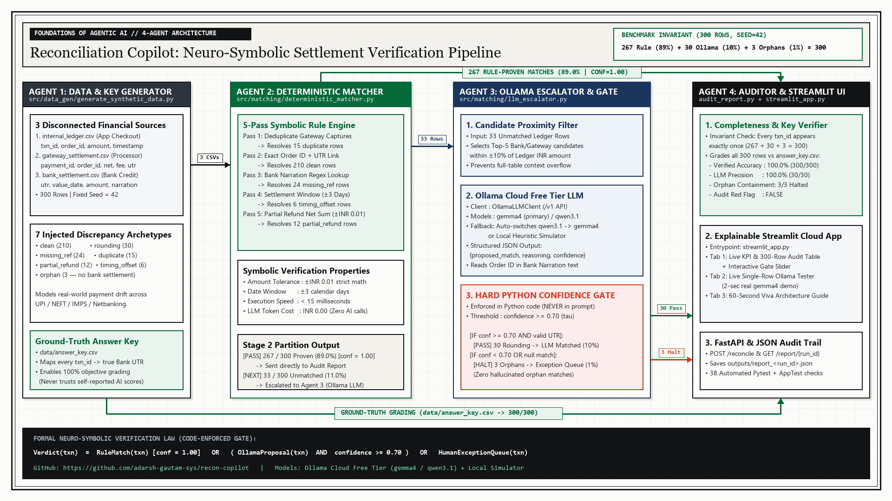

# Reconciliation Copilot

**Course Submission:** Foundations of Agentic AI  
**Repository:** [https://github.com/adarsh-gautam-sys/recon-copilot](https://github.com/adarsh-gautam-sys/recon-copilot)

A neuro-symbolic, 4-agent financial reconciliation system that verifies transactions across three disconnected settlement sources (**Internal Ledger**, **Payment Gateway**, and **Bank Statement**). It executes deterministic mathematical rules first, escalates only genuinely ambiguous rows to an LLM via **Ollama Cloud Free Tier (`gemma4` / `qwen3.1`)**, and enforces a hard code-level confidence gate ($\tau \ge 0.70$) so unresolvable discrepancies are routed to a categorized human exception queue rather than hallucinated.

> **Core Architectural Thesis:** *"Verification capacity, not generation speed, is the bottleneck."*  
> Pure LLM agents optimize for plausibility rather than provability. In financial control, a false-positive match is worse than an honest exception. Reconciliation Copilot treats the LLM strictly as a bounded proposer behind symbolic rules and a Python confidence gate.

---

## 1. System Architecture & 4-Agent Pipeline



### Interactive Architecture Flowchart (Mermaid)

```mermaid
%%{init: {'theme': 'base', 'themeVariables': {'primaryColor': '#F4F6F8', 'primaryTextColor': '#111315', 'primaryBorderColor': '#111315', 'lineColor': '#111315', 'secondaryColor': '#EAF4EE', 'tertiaryColor': '#FBFBF9', 'fontFamily': 'Segoe UI, Inter, sans-serif', 'fontSize': '15px'}, 'flowchart': {'nodeSpacing': 28, 'rankSpacing': 48, 'curve': 'basis', 'padding': 14}}}%%
flowchart LR
    subgraph A1["AGENT 1: DATA & KEY GENERATOR"]
        direction TB
        SRC["3 Disconnected CSVs (300 Rows, seed=42)<br/>• internal_ledger.csv<br/>• gateway_settlement.csv<br/>• bank_settlement.csv"]
        NOISE["7 Injected Discrepancy Types<br/>clean (210) · rounding (30) · missing_ref (24)<br/>duplicate (15) · partial_refund (12) · timing (6) · orphan (3)"]
        KEY[("answer_key.csv<br/>Immutable Ground Truth")]
        SRC --- NOISE
    end

    subgraph A2["AGENT 2: DETERMINISTIC RULE MATCHER"]
        direction TB
        RULES["deterministic_matcher.py<br/>5-Pass Symbolic Engine:<br/>1. Deduplicate Gateway<br/>2. Exact Order ID + UTR<br/>3. Narration Regex Lookup<br/>4. Date Window (±3 Days)<br/>5. Partial Refund Net (±₹0.01)"]
        R_OUT["267 / 300 Proven Matches (89.0%)<br/>Confidence = 1.00 · Zero AI Cost"]
        RULES --> R_OUT
    end

    subgraph A3["AGENT 3: OLLAMA LLM ESCALATOR + GATE"]
        direction TB
        CAND["Top-5 Bank Candidates<br/>(±10% Amount Proximity Window)"]
        LLM["Ollama Cloud Free Tier<br/>Models: gemma4 / qwen3.1<br/>JSON: {proposed_match, reasoning, confidence}"]
        GATE{"Python Hard Gate<br/>confidence >= 0.70?"}
        CAND --> LLM --> GATE
    end

    subgraph A4["AGENT 4: GROUND-TRUTH AUDITOR & UI"]
        direction TB
        AUDIT["audit_report.py<br/>• Completeness Check (267+30+3 = 300)<br/>• Verified Accuracy: 100.0% (300/300)<br/>• LLM Precision: 100.0% (30/30)"]
        UI["Explainable Interfaces<br/>• Streamlit App (streamlit_app.py)<br/>• FastAPI (/reconcile + Workbench)"]
        AUDIT --> UI
    end

    SRC ==>|"300 Rows"| RULES
    R_OUT ==>|"267 Rule-Proven (89%)"| AUDIT
    RULES ==>|"33 Unmatched Rows (11%)"| CAND
    GATE ==>|"PASS (>= 0.70): 30 Rounding (10%)"| AUDIT
    GATE -.->|"HALT (< 0.70): 3 Orphans (1%)"| AUDIT
    KEY -.->|"Grades All 300 Rows"| AUDIT

    style A1 fill:#F8F7F4,stroke:#111315,stroke-width:2px
    style A2 fill:#EAF4EE,stroke:#046A38,stroke-width:2px
    style A3 fill:#EEF3F8,stroke:#1B365D,stroke-width:2px
    style A4 fill:#F4F6F8,stroke:#111315,stroke-width:2px
    style GATE fill:#FDECEC,stroke:#D9381E,stroke-width:2px,color:#D9381E
    style R_OUT fill:#D6EFE0,stroke:#046A38,stroke-width:1.5px
    style KEY fill:#D6EFE0,stroke:#046A38,stroke-width:1.5px
```



### The 4 Agents Explained

| Agent | Source File | Core Role | Output & Guardrail |
| :--- | :--- | :--- | :--- |
| **Agent 1: Synthetic Benchmark & Key Generator** | `src/data_gen/generate_synthetic_data.py` | Generates 300 reproducible transactions (`seed=42`) across 3 CSVs with 7 real-world discrepancy archetypes, plus `data/answer_key.csv`. | Produces an immutable ground-truth mapping (`txn_id -> true UTR`) so the AI never grades itself. |
| **Agent 2: Deterministic Symbolic Rule Matcher** | `src/matching/deterministic_matcher.py` | Executes 5-pass symbolic verification: gateway deduplication, exact UTR/Order ID join, bank narration regex lookup, ±3-day settlement window, and partial-refund net aggregation within ±₹0.01. | Resolves **267 / 300 rows (89.0%)** in `<15ms` at `confidence = 1.00`; forwards 33 unresolved rows to Agent 3. |
| **Agent 3: Ollama LLM Escalator & Code Gate** | `src/matching/llm_escalator.py` | Filters top-5 bank candidates within ±10% of the ledger amount and prompts **Ollama Cloud Free Tier (`gemma4` / `qwen3.1`)** for structured JSON `{proposed_match, reasoning, confidence}`. | Enforces `confidence >= 0.70` in Python code—resolving **30 rounding-drift rows** while blocking **3 true orphans**. |
| **Agent 4: Ground-Truth Auditor & Reporter** | `src/reporting/audit_report.py` | Validates the completeness invariant (`267 + 30 + 3 == 300`), scores every row against `answer_key.csv`, computes `llm_precision`, and checks for over-matching (`red_flag`). | Writes `outputs/report_<run_id>.json` and feeds the Streamlit & FastAPI interfaces. |

**Formal Verification Law:**
$$\text{Verdict}(x) = \text{RuleMatch}(x)_{[\text{conf}=1.0]} \;\lor\; \big(\text{OllamaProposal}(x) \land \text{conf}(x) \ge 0.70\big) \;\lor\; \text{ExceptionQueue}(x)$$

---

## 2. Problem Statement & Discrepancy Taxonomy

When a customer completes a digital payment, three independent systems log the event:
1. **Internal Ledger (`data/internal_ledger.csv`)** — application checkout record (`txn_id`, `order_id`, `amount`, `currency`, `timestamp`, `status`).
2. **Payment Gateway (`data/gateway_settlement.csv`)** — processor payout record (`payment_id`, `order_id`, `utr`, `amount` net of fee, `fee`, `settled_at`).
3. **Bank Statement (`data/bank_settlement.csv`)** — bank credit statement (`utr`, `amount`, `value_date`, free-text `narration`).

Real-world settlement files exhibit seven distinct discrepancy archetypes:

| Archetype | Share (`300` Rows) | Discrepancy Mechanism | Resolution Stage |
| :--- | :---: | :--- | :--- |
| `clean` | `210 (70%)` | Exact amount, valid UTR link, settled within 0–2 days | **Agent 2 (Rule Pass 2)** |
| `rounding` | `30 (10%)` | Bank credit drifts by ±₹0.02–₹2.00; Order ID present in narration | **Agent 3 (Ollama LLM >= 0.70)** |
| `missing_ref` | `24 (8%)` | Bank `utr` column blank; `ORD_xxxxx` embedded in free-text narration | **Agent 2 (Rule Pass 3)** |
| `duplicate` | `15 (5%)` | Gateway emits duplicate retry row (`DUP_PAY_xxxxx`) for same order | **Agent 2 (Rule Pass 1)** |
| `partial_refund` | `12 (4%)` | Original capture + negative refund row sum to net settled amount | **Agent 2 (Rule Pass 5)** |
| `timing_offset` | `6 (2%)` | Bank `value_date` delayed by +1 to +3 calendar days | **Agent 2 (Rule Pass 4)** |
| `orphan` | `3 (1%)` | Transaction captured in ledger, but no bank/gateway settlement exists | **Agent 3 Halted -> Human Queue** |

---

## 3. Quick Start & Deployment

### Prerequisites
- Python 3.10+

```bash
# 1. Clone the repository
git clone https://github.com/adarsh-gautam-sys/recon-copilot.git
cd recon-copilot

# 2. Install dependencies
pip install -r requirements.txt
```

### Option A: Interactive Streamlit App (Recommended)

```bash
streamlit run streamlit_app.py
```

Opens **`http://localhost:8501`** with three interactive tabs:
1. **📊 1. Reconciliation Results:** 4 KPI cards, real-time confidence gate slider ($\tau \in [0.10, 0.99]$), ground-truth verification badge, 7-archetype breakdown table, and filterable 300-row audit trail with JSON export.
2. **🧪 2. Live Ollama (`gemma4` / `qwen3.1`) Tester:** Pick any single unmatched transaction from the 33 unresolved rows and invoke Ollama Cloud live in ~2 seconds to inspect the raw JSON verdict, reasoning, and confidence gate ruling.
3. **🏗️ 3. 4-Agent System Architecture:** Full architectural diagram and stage-by-stage technical specification.

### Deploying on Streamlit Community Cloud
1. Go to [share.streamlit.io](https://share.streamlit.io) and click **New app**.
2. Select repository **`adarsh-gautam-sys/recon-copilot`**, branch **`main`**, and main file path **`streamlit_app.py`**.
3. *(Optional)* In **App settings → Secrets**, set:
   ```toml
   OLLAMA_API_KEY = "your-ollama-cloud-api-key"
   OLLAMA_HOST = "https://ollama.com/v1"
   ```

### Option B: CLI Pipeline Runner

```bash
# Run with the bounded heuristic agent simulator (default, <1 second, 100% verified)
python run_demo.py --mode heuristic

# Run deterministic rule-only baseline (offline mode)
python run_demo.py --mode offline

# Run live Ollama Cloud escalation (gemma4 or qwen3.1)
python run_llm_escalation.py --model gemma4 --probe-only
```

### Option C: FastAPI Backend & Web Workbench

```bash
uvicorn src.api.main:app --reload --port 8000
```

- `GET /` — Serves the Statistical Bulletin web workbench (`src/api/static/index.html`).
- `GET /health` — Liveness probe (`{"status": "ok", "version": "1.0.0"}`).
- `POST /reconcile` — Runs the 4-agent pipeline (`llm_mode`: `"heuristic"` | `"ollama"` | `"offline"`).
- `GET /report/{run_id}` — Fetches any saved JSON audit report from `outputs/`.

---

## 4. Empirical Evaluation Results (`seed=42`, 300 Rows)

All metrics are computed objectively against `data/answer_key.csv` by `src/reporting/audit_report.py`:

| Metric | Rule-Only Baseline (`offline`) | Hybrid 4-Agent Pipeline (`heuristic` / `ollama`) |
| :--- | :---: | :---: |
| **Total Ledger Rows** | `300` | `300` |
| **Stage 1: Deterministic Rule-Matched** | `267 / 300 (89.0%)` | `267 / 300 (89.0%)` |
| **Stage 2: LLM-Matched ($\ge 0.70$)** | `0 / 300 (0.0%)` | `30 / 300 (10.0%)` |
| **Stage 3: Unresolved Exceptions ($< 0.70$)** | `33 / 300 (11.0%)` | `3 / 300 (1.0% — all 3 true orphans)` |
| **LLM Escalation Precision vs. Key** | `N/A` | **`100.0% (30 / 30)`** |
| **Verified Accuracy vs. Answer Key** | **`90.0% (270 / 300)`** | **`100.0% (300 / 300)`** |
| **Audit Red Flag (`red_flag`)** | `False` | `False` |

---

## 5. Key Engineering Decisions & Trade-Offs

### 1. Ollama Cloud Free Tier (`gemma4` / `qwen3.1`) + Protocol Abstraction
The LLM interface in `src/matching/llm_escalator.py` is a single-method Python `Protocol` (`complete(system, user) -> str`). `OllamaLLMClient` connects to Ollama's OpenAI-compatible `/v1` endpoint (`https://ollama.com/v1` for Ollama Cloud Free Tier or `http://localhost:11434/v1` for local Ollama daemons). If `qwen3.1` returns HTTP 404 on a free-tier cloud plan, `OllamaLLMClient` automatically falls back to `gemma4` so pipeline runs never crash.

### 2. Code-Enforced Confidence Gate ($\tau = 0.70$)
Prompting an LLM with *"only return matches above 0.70 confidence"* fails because the model simply inflates its reported confidence to `0.75`. Instead, `_SYSTEM_PROMPT` never mentions the threshold `0.70`, and `LLMEscalator._process_one` enforces `if llm_resp.confidence < self.cfg.confidence_threshold` in Python code.

### 3. `pandas` vs. `cuDF` (RAPIDS)
RAPIDS (`cuDF`) requires an NVIDIA GPU and matching CUDA toolkit, which introduces deployment friction on CPU-only cloud hosts (such as Streamlit Community Cloud). The pipeline is built on standard `pandas` data structures and completes 300-row symbolic matching in `<15ms`, while remaining 100% compatible with `import cudf.pandas as pd` as a zero-code-change GPU drop-in accelerator.

### 4. Cross-Platform UTF-8 & Resilient JSON Parsing
All file I/O explicitly specifies `encoding="utf-8"` to avoid Windows `cp1252` `UnicodeEncodeError` crashes. `LLMEscalator._parse_response` strips markdown fences, extracts `{...}` JSON blocks when models emit reasoning prose, and normalizes string literals such as `"null"` or `"(none)"` to Python `None`.

---

## 6. Automated Test Suite

The repository includes **38 automated tests** across 6 test modules (including a full `streamlit.testing.v1.AppTest` integration check for `streamlit_app.py`), executing in under 5 seconds with zero external network calls:

```bash
python -m pytest tests/ -v
```

| Test Suite | Tests | Coverage Focus |
| :--- | :---: | :--- |
| `tests/test_data_gen.py` | `5` | Seed determinism, 7-category noise distribution, answer key integrity, orphan isolation, partial refund math |
| `tests/test_deterministic_matcher.py` | `8` | Exact match, ±₹0.01 boundary tolerance, ±3-day settlement window boundaries, duplicate protection, orphan safety |
| `tests/test_llm_escalator.py` | `6` | Mocked LLM escalation, hard 0.70 confidence gate, `null` match handling, malformed JSON recovery, API timeout safety |
| `tests/test_audit_report.py` | `9` | 300-row completeness invariant (missing/duplicate row detection), precision math, exception breakdown, JSON output |
| `tests/test_integration.py` | `3` | End-to-end 4-agent pipeline execution and per-archetype audit verification |
| `tests/test_api.py` | `7` | FastAPI endpoints (`/health`, `/reconcile`, `/report/{run_id}`), `OllamaLLMClient` (`gemma4` / `qwen3.1`), and Streamlit `AppTest` UI rendering |

---

## 7. Repository Structure

```text
reconciliation-copilot/
├── README.md                          # Project documentation & architecture guide
├── streamlit_app.py                   # Streamlit Community Cloud deployment entrypoint
├── requirements.txt                   # Python dependencies
├── Makefile                           # Shortcut targets (demo, test, serve, clean)
├── run_demo.py                        # One-command CLI pipeline runner
├── run_llm_escalation.py              # Live Ollama Cloud (gemma4 / qwen3.1) CLI probe & runner
├── docs/
│   ├── PRD.md                         # Product Requirements Document (Foundations of Agentic AI)
│   ├── architecture_diagram_16x9.png  # 16:9 High-Resolution 4-Agent Architecture Blueprint
│   └── mermaid_architecture_16x9.png  # 16:9 Rendered Mermaid Flowchart
├── src/
│   ├── config.py                      # Typed configuration dataclasses (MatcherConfig, EscalatorConfig)
│   ├── data_gen/
│   │   └── generate_synthetic_data.py # Agent 1: Synthetic CSV & answer_key.csv generator
│   ├── matching/
│   │   ├── deterministic_matcher.py   # Agent 2: 5-pass symbolic rule matcher
│   │   └── llm_escalator.py           # Agent 3: OllamaLLMClient + LLMEscalator + 0.70 code gate
│   ├── reporting/
│   │   └── audit_report.py            # Agent 4: Completeness check & answer-key audit reporter
│   └── api/
│       ├── main.py                    # FastAPI application (/health, /reconcile, /report/{run_id})
│       ├── pipeline.py                # 4-stage pipeline orchestrator (heuristic, ollama, offline)
│       └── static/
│           └── index.html             # FastAPI Statistical Bulletin web workbench
├── data/
│   ├── internal_ledger.csv            # 300-row synthetic internal ledger (seed=42)
│   ├── gateway_settlement.csv         # Synthetic payment gateway settlement records
│   ├── bank_settlement.csv            # Synthetic bank statement records
│   └── answer_key.csv                 # Generator-only ground-truth evaluation key
├── outputs/
│   └── .gitkeep                       # Directory for generated timestamped JSON audit reports
└── tests/
    ├── test_data_gen.py
    ├── test_deterministic_matcher.py
    ├── test_llm_escalator.py
    ├── test_audit_report.py
    ├── test_integration.py
    └── test_api.py
```
